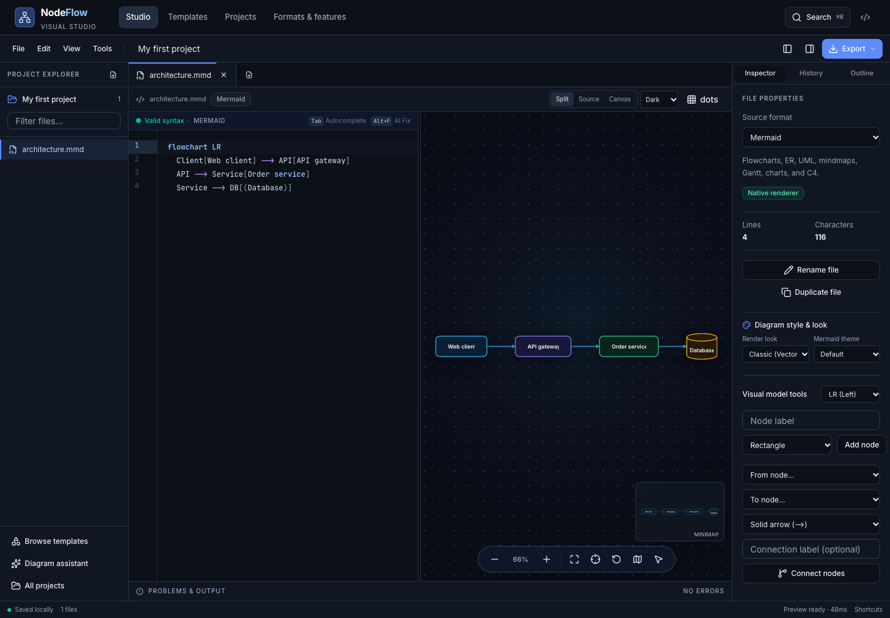

# NodeFlow — Visual Diagram & Architecture Studio

An open source, browser-based, local-first studio for diagrams, data models, architecture, and mind maps. Work in projects with multiple source files, a high-performance code editor, a live diagram canvas, syntax diagnostics, format converters, and version checkpoints.

[Open the application](https://muhamadzolfaghari.github.io/node-flow/) · [Format registry](src/lib/formats.js) · [Design system](docs/DESIGN-SYSTEM.md) · [Initial audit](docs/DESIGN-AUDIT.md)

## Workspace

- **Projects and files:** create and rename projects, import source files or folders, switch document tabs, duplicate and rename files, and search the explorer.
- **Code editor:** CodeMirror with language highlighting, Mermaid completions, bracket matching, folding, search, undo/redo, and independent document histories.
- **Live previews:** Mermaid and Graphviz render natively. Other supported languages retain their original editable source and derive a Mermaid preview. Diagnostics explain parser failures and conversion limits. Invalid edits retain the last valid preview for that file.
- **Visual diagram editing:**
  - *Flowcharts:* select labeled nodes, rename labels, switch node shapes (8 shapes: rectangle, rounded, stadium, subroutine, cylinder, circle, diamond, hexagon), apply color accent palettes, switch layout direction (TD, LR, BT, RL), duplicate nodes with style cloning, connect existing nodes with customizable arrow styles (solid, dotted, thick, open, etc.), inspect incoming and outgoing connections with one-click edge disconnection, quick-add connected child steps, and delete nodes with clean edge cascade.
  - *Sequence diagrams:* visual participant and actor management, message passing with arrow styles (synchronous, dotted reply, async, failure), and clean participant deletion.
  - *Class diagrams:* class creation, attribute and method declarations, UML relationships (inheritance, composition, aggregation, association, dependency, realization), and class deletion.
  - *State diagrams:* visual state declaration with descriptive labels, state transition connector with event triggers, state removal, and initial/terminal state integration (`[*]`).
  - *Entity-Relationship (ER) diagrams:* visual entity management, typed attributes with primary key (PK) / foreign key (FK) indicators, relational cardinality connectors (`||--||`, `||--o{`, `}|--|{`, `|o--||`, etc.), and entity deletion.
  - *Mindmaps:* topic hierarchy viewer with indent visualization, subtopic branch insertion with custom shapes (circle, square, rounded, cloud, bang), and single-click branch subtree deletion.
  - *Git graphs:* branch management, commit generation with tags and highlight types, branch checkout, and branch merging with release tags.
  - *Diagram look & themes:* one-click render look toggle (Classic vector vs. Hand-drawn sketchy) and Mermaid theme selection (Default, Neutral, Dark, Forest, Base) managed through clean frontmatter directives. Changes update source in real time.
- **Canvas:** pan, zoom, fit, center, minimap navigation, grid styles, wheel pan/zoom modes, arrow-key navigation, pinch zoom, and presentation mode with a laser pointer.
- **Version checkpoints:** save up to 30 project snapshots and restore the original source of a file.
- **Project portability & exports:** download SVG with embedded roundtrip source metadata, high-res PNG (2×, 4×), print-ready PDF, standalone offline interactive HTML viewer, 16:9 widescreen PowerPoint presentation slides (`.pptx`), `.atlas` project backups, and ZIP source archives.
- **Diagram assistant:** local rule-based drafts, plus optional Qwen2.5-Coder inference through WebLLM. Qwen requires WebGPU and downloads model weights on first use; no API key is needed. Generated drafts open as new files for review.

## Supported source formats

All 34 entries are available in the new-file dialog, file inspector, and import workflow. Formats are defined once in `src/lib/formats.js`; the Formats page displays the same registry. Full matrix: [docs/FORMATS-ALL.md](docs/FORMATS-ALL.md). Syntax-error database: [docs/SYNTAX-ERROR-DB.md](docs/SYNTAX-ERROR-DB.md). 50-phase plan: [docs/UNIVERSAL-50-PHASE-PLAN.md](docs/UNIVERSAL-50-PHASE-PLAN.md).

| Format | Input | Editing and preview scope |
| --- | --- | --- |
| Mermaid | `.mmd`, `.mermaid`, detected plain text | Native Mermaid rendering: flowcharts, ER, UML class/sequence/state, mindmaps, Gantt, C4, journeys, timelines, Git graphs, Sankey, pie, XY, quadrant, Kanban, block, requirement, and packet diagrams. |
| Graphviz | `.dot`, `.gv` | Native DOT rendering through Graphviz WebAssembly. |
| PlantUML | `.puml`, `.plantuml` | Sequence, class, and state subsets to Mermaid. Vendor styling, macros, and full PlantUML grammar are not implemented. |
| D2 | `.d2` | Basic nodes, connections, and containers to Mermaid; approximate layout and styling. |
| SQL DDL | `.sql` | CREATE TABLE columns and foreign keys to ER diagrams. Complex dialect syntax may require simplification. |
| GraphQL SDL | `.graphql`, `.gql` | Types, fields, and relationships to a class diagram. |
| OpenAPI / Swagger | `.json`, `.yaml`, `.yml` | Specification content detection; request sequences from the first 10 paths. |
| AsyncAPI | `.json`, `.yaml`, `.yml` | Specification content detection; event sequences from the first 12 channels, v2/v3. |
| Draw.io | `.drawio`, detected `.xml` | Plain or compressed first-page XML nodes and edges to Mermaid. Original XML remains editable; vendor shapes, geometry, and styling are not reproduced. |
| BPMN 2.0 | `.bpmn`, detected `.xml` | Tasks, events, gateways, and sequence flows to Mermaid; no BPMN execution semantics. |
| C4 / Structurizr DSL | `.dsl`, `.c4` | Basic people, systems, containers, and relationships to C4 context. |
| Terraform HCL | `.tf` | Resources and direct references to architecture graphs. Modules, dynamic blocks, and evaluated values are not resolved. |
| Markdown outlines | `.md`, `.markdown`, `.txt` | Indented outlines to mindmaps, or the first embedded Mermaid code fence. |
| CSV | `.csv` | Source/target relationship rows to a graph. |
| FreeMind | `.mm`, detected `.xml` | Topic hierarchy to a mindmap. |
| OPML | `.opml`, detected `.xml` | Outline hierarchy to a mindmap. |
| XMind | `.xmind` | First sheet of ZEN or legacy workbooks becomes an editable Mermaid mindmap. The imported workbook is retained separately; current mindmaps export to a new XMind workbook. |
| StarUML | `.mdj` | StarUML JSON models (`_type: Project` / `UMLClass`) with attributes, operations, and UML generalizations / associations compiled to editable class diagrams. |
| Lucidchart | `.lucid`, detected `.csv` | Lucidchart CSV or JSON model export converted into editable Mermaid flowchart nodes and labeled line connections. |
| GeoJSON / GIS | `.geojson`, `.geo.json` | GeoJSON FeatureCollections, spatial layers, Mapbox Vector Tile (MVT) protobuf schemas, and topological routes converted to structured diagrams. |
| Source code | `.ts`, `.tsx`, `.js`, `.jsx`, `.py`, `.java`, `.cs`, `.go`, `.rs`, `.kt`, `.swift`, `.php`, `.rb`, `.cpp`, `.c` | Best-effort class/struct/enum extraction to UML. Imported code is not executed. |
| JSON Schema / DBML / Prisma / Protobuf / ERD text / YAML | `.schema.json`, `.dbml`, `.prisma`, `.proto`, `.erd`, `.yaml`, `.yml` (+ content detection) | Schemas and models to class/ER diagrams. |
| UML XMI / SysML v2 / ArchiMate / DMN / Visio / Gliffy / Excalidraw | `.xmi`, `.uml`, `.sysml`, `.dmn`, `.vdx`, `.gliffy`, `.excalidraw` (+ content detection) | Vendor UML/BPMN/whiteboard sources to editable Mermaid. |

Reverse export: Mermaid class → PlantUML/TypeScript/UML-XMI, ER → SQL/DBML, sequence → PlantUML/OpenAPI stub, flowchart → DOT/D2, mindmap → Markdown/OPML/XMind.

Derived previews are models of supported syntax, not lossless vendor renderers. Exporting original source preserves the source as edited; exporting Mermaid downloads the derived view. Unrecognized JSON/XML is rejected with an explanation instead of silently treated as Mermaid.

### Cross-Disciplinary Templates & Role Workflows

The studio features curated templates tailored for every role across modern engineering and enterprise organizations:
- **Product Managers (PM)**: User story mapping (backbone vs. MVP/V2 release slices), strategic quarterly OKRs, and customer journey maps.
- **QA & Testing Engineers**: Defect triage lifecycles, automated CI/CD quality gates with multi-tier smoke checks, and regression verification flows.
- **Developers & DevOps**: Cloud microservice architecture, ER schemas, git trunk flows, and GIS vector tile data pipelines.
- **Operations & Business**: Standard Operating Procedures (SOP) with compliance review chains and corporate org charts.
- **Students & Researchers**: Doctoral/master thesis structure maps, scientific method lab protocols, and semester course study plans.
- **14 UML Specifications**: Class, sequence, state, component, deployment, usecase, activity, package, and timing models.

### Visual modeling suite

DiagramAtlas provides interactive, bidirectional visual modeling panels in the Inspector tab for all major diagram families:
- **Flowcharts**: 8 shape presets (process, round, subroutine, database, circle, decision, asymmetric, hexagon), 7 curated color styles, 6 arrow connector styles, layout direction switcher (TD, LR, BT, RL), duplication with style cloning, quick-add child step, cascading node deletion, and edge inspection with targeted disconnection.
- **Sequence Diagrams**: Participant & actor declaration with custom aliases, typed message passing (`->>`, `-->>`, `-x`, `--)`), and safe participant deletion.
- **Class Diagrams**: Class creation, typed attributes and methods (`+`, `-`, `#`, `~`), UML relationships (`<|--`, `*--`, `o--`, `-->`, `..>`), and cascading class deletion.
- **State Diagrams**: Composite states, transition events with descriptive labels, and state removal.
- **Entity Relationship (ER) Diagrams**: Entities, typed attributes with PK/FK/UK constraints, relationship cardinalities (`||--o{`, `}|--|{`, etc.), and entity removal.
- **Mindmaps**: Visual topic hierarchy traversal, subtree branch insertion with 6 node shapes, and safe branch subtree deletion.
- **Git Graphs**: Branch creation, branch switching / checkout, commits with messages, tags, and types (`NORMAL`, `REVERSE`, `HIGHLIGHT`), and branch merging with semantic release tags.
- **Pie Charts**: Real-time chart title updates, slice additions with positive numerical weights, and slice deletion.
- **User Journey Maps**: Journey stage / section organization, task addition with satisfaction scores (1–5) and multiple participating actors, and task deletion.
- **Kanban Boards**: Dynamic column creation, card insertion under targeted workflow columns, and single-click card deletion.
- **Gantt Charts**: Roadmap workstream section management, task scheduling with status tags (`active`, `done`, `crit`, `milestone`), duration specifications, and task deletion.
- **Quadrant Charts**: Eisenhower and feature prioritization matrices with point coordinates ([x, y]), custom item addition, and point deletion.
- **Timelines & Timing Diagrams**: Milestone period organization, event addition with detailed descriptions, and event deletion.
- **Sankey Diagrams**: Interactive flow funnel modeling with source-target nodes, flow volume weights, and flow link deletion.
- **XY Metric Charts**: Performance benchmark and metrics modeling with interactive title updates, bar/line series addition, and series deletion.
- **Block Architecture Diagrams**: Multi-column hardware/system block modeling with configurable grid columns, span controls, block element addition, and block deletion.
- **C4 Architecture Models**: Full Context/Container/Component modeling with Person, System, Database, and Component declaration, relationship direction and protocols (`Rel`), and element deletion.
- **Requirement Diagrams**: Systems engineering requirements modeling with functional/performance requirement definitions, risk levels, verification methods, system elements, traceability links (`satisfies`, `traces`, `derives`, `refines`, `copies`, `contains`), and element/requirement deletion.
- **Packet & Bytefield Diagrams**: Network protocol header and binary structure modeling with bitfield ranges, single-bit flags, field width calculations, and field deletion.
- **Cloud & Architecture Diagrams**: Cloud microservices and VPC topology modeling with group boundaries, service declarations with icon presets (server, database, cloud, disk, internet, key, user), port/side directional connections (`R`, `L`, `T`, `B`), and element deletion.
- **Look & Feel / Theming**: Vector crisp vs. Hand-drawn sketchy look switcher, plus 5 theme presets (Default, Neutral, Forest, Dark, Base).

## Exports

- Original editable source in its file format.
- Derived Mermaid source, except native Graphviz previews.
- Derived code, schema, and outline specifications: PlantUML (`.puml`), Graphviz DOT (`.dot`), D2 (`.d2`), SQL DDL (`.sql`), DBML (`.dbml`), TypeScript stubs (`.ts`), UML XMI 2.1 (`.xmi`), OPML outlines (`.opml`), Markdown outlines (`.md`), and OpenAPI 3.0 specifications (`.json`) extracted from sequence diagrams.
- SVG vector diagrams with embedded diagram source metadata (`<metadata>` and XML comments) so exported `.svg` files can be dropped back into the studio to resume editing with 100% fidelity.
- PNG at 2× or 4× scale; dimensions depend on the diagram.
- PDF with a high-resolution raster image (not vector PDF).
- Standalone HTML containing the rendered diagram and navigation controls.
- XMind workbook for mindmaps.
- `.atlas` backups including project files, open tabs, snapshots, and retained original XMind workbooks.
- ZIP archives with editable source files and a restorable project backup.

Resolve current preview errors before exporting a diagram image. Switch to Canvas or Split view to export images from the current SVG.

## Local storage and privacy

The application has no account service or application backend. Projects are stored in this browser's local storage. Existing NodeFlow/DiagramAtlas drafts and named diagrams remain accessible; they are not deleted during migration.

Browser storage is device- and browser-specific, has a quota, and can be cleared by the user. Download project backups for durable copies. If storage fills, the workspace reports it and still allows a backup download. Source imports are limited to 15 MB per file and 100 files per project; expanded ZIP input is limited to 30 MB.

Libraries, fonts, and optional model weights may be fetched over the network. Source processing runs in the browser. An offline installation is not guaranteed by the hosted application; there is no service worker or shared cloud collaboration in this version.

## Design and navigation

Tailwind v4 semantic tokens, locally owned shadcn/ui/Radix primitives, and CVA variants provide consistent controls and accessible menus and dialogs. React Router uses hash URLs to support direct page refreshes on GitHub Pages:

- `#/` — home and live examples
- `#/studio` — workspace
- `#/studio?project=<id>` — a local project
- `#/studio?template=<id>` — add a template file
- `#/templates` — searchable collections, with URL-based filters
- `#/saved` — Projects and previously saved diagrams
- `#/formats` — supported source formats and conversion limits

The old `#/compare` address redirects to Formats. Unknown routes display a not-found page.

## Reviewed designs



See [verification results and limits](docs/VERIFICATION.md) and the [desktop and phone screenshots](screenshots/enterprise).

## Keyboard controls

| Action | Shortcut |
| --- | --- |
| Save locally | `Ctrl/Cmd + S` |
| Open files | `Ctrl/Cmd + O` or `Ctrl/Cmd + I` |
| New file | `Ctrl/Cmd + Shift + N` |
| Search commands | `Ctrl/Cmd + K` |
| Find in source | `Ctrl/Cmd + F` |
| Undo / redo | Platform editor shortcuts |
| Indent / dedent | `Tab` / `Shift + Tab` |
| Fit / center / reset canvas | `F` / `C` / `0` |
| Zoom | `+` / `−` |
| Pan | Drag or arrow keys; Shift + arrows for larger steps |
| Quick-add child step | `Tab` / `Enter` (canvas with node selected) |
| Duplicate selected node | `Ctrl/Cmd + D` (canvas with node selected) |
| Delete selected node | `Delete` / `Backspace` (canvas with node selected) |
| Keyboard help | `?` outside an editor |

## Development

Use Node.js 22 or newer and npm.

```sh
git clone https://github.com/muhamadzolfaghari/node-flow.git
cd node-flow
npm ci
npm run dev
```

```sh
npm run build
npm test
npm run test:unit
npm run test:browser
```

Production files are generated in `dist/`, with the GitHub Pages base path `/node-flow/` (or `/diagram-atlas/`, configurable via `VITE_BASE_URL`). The browser suite starts its own local server, exercises source formats and workspace workflows, and closes it afterward. Set `ATLAS_TEST_URL` to use an existing server.

## License

MIT, as declared in `package.json`. Dependencies retain their individual licenses.
